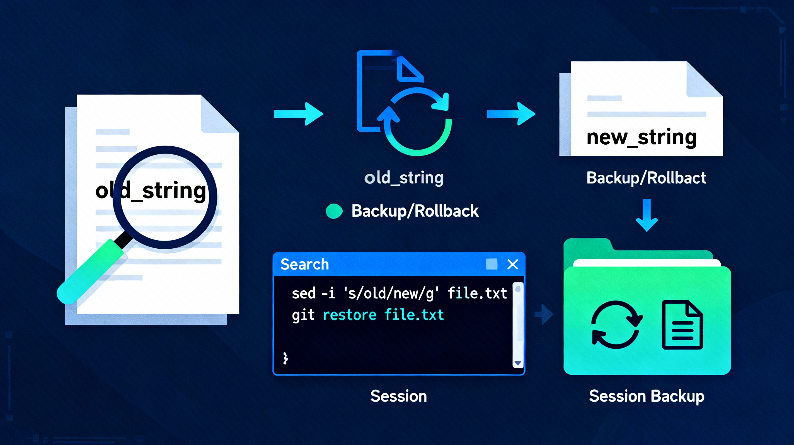
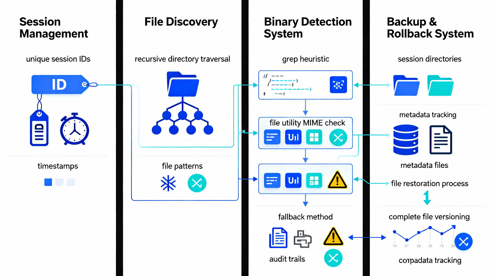
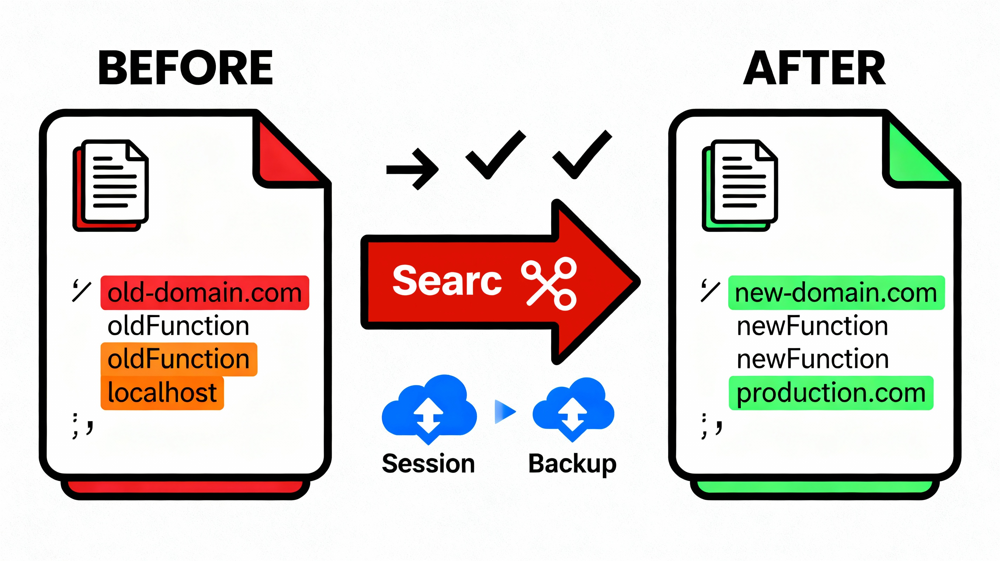
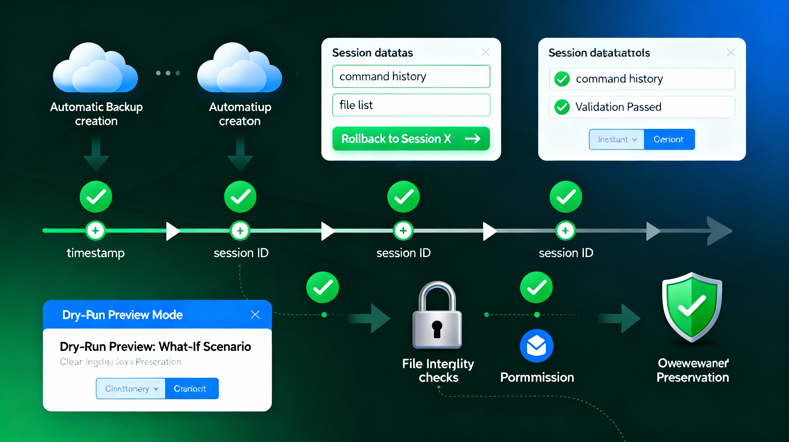
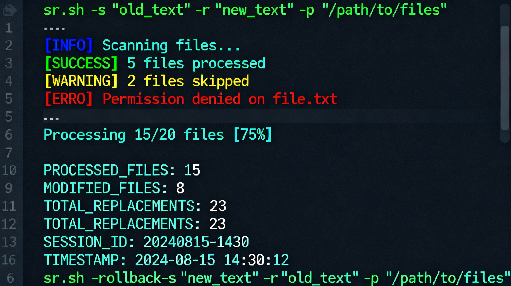
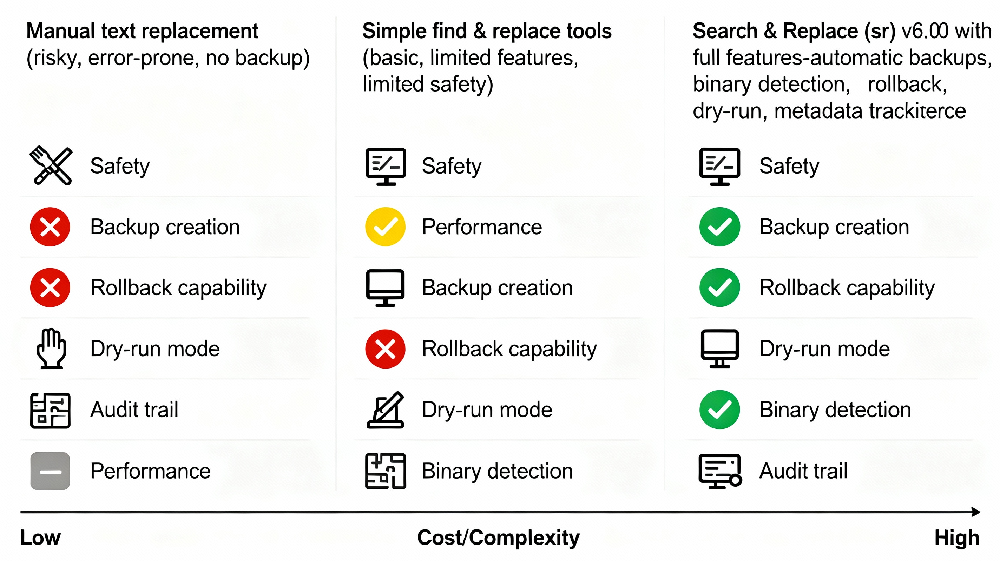

# Search & Replace (sr) v6.0.0 - Illustrations Gallery

> **Historical document (sr 6.x).** Superseded by sr 7 — see [README.md](README.md),
> `sr help examples` and [docs/MIGRATION-6-to-7.md](docs/MIGRATION-6-to-7.md).
> Kept at this path so existing links keep resolving; the text below is unchanged.

Visual guides and diagrams to understand the Search and Replace utility.

## 🎯 Workflow Overview

*Main workflow illustration showing the search and replace process with session-based rollback capabilities. The diagram demonstrates how files are discovered, processed, backed up, and can be restored in one command.*

## 🏗️ System Architecture

*Technical architecture diagram showing the four main components:*
- **Session Management** - Unique IDs and timestamp tracking
- **File Discovery** - Recursive directory traversal with pattern matching
- **Binary Detection** - Three-layer detection system for file type identification
- **Backup & Rollback** - Session-based backup storage with restoration capability

## 🔄 Before/After Transformation

*Visual comparison showing file transformations:*
- Left side: Original files with outdated patterns (highlighted in red)
- Center: Search and replace operation
- Right side: Updated files with new patterns (highlighted in green)
- Includes automatic backup creation indicators

## 🛡️ Safety & Rollback Timeline

*Timeline visualization demonstrating:*
- Session checkpoints with timestamps and IDs
- Automatic backup creation at each session
- Session metadata and command history tracking
- One-command rollback to any previous session
- File integrity validation and permission preservation
- Dry-run preview mode capability

## 💻 Terminal Usage Example

*Realistic terminal window showing:*
- Color-coded output with [INFO], [SUCCESS], [WARNING], [ERROR] messages
- Typical sr.sh command examples with proper syntax
- Processing statistics and progress indicators
- Session ID with timestamp
- Rollback command examples
- Actual terminal-like appearance for authenticity

## 📊 Feature Comparison

*Detailed feature comparison between:*
1. **Manual Text Replacement** - Risky, error-prone, no backup
2. **Simple Find & Replace Tools** - Basic functionality, limited safety
3. **Search & Replace (sr) v6.0.0** - Enterprise-grade with full features

Features evaluated:
- ✅ Safety mechanisms
- ✅ Automatic backup creation
- ✅ Rollback capability
- ✅ Dry-run preview mode
- ✅ Performance optimization
- ✅ Binary file detection
- ✅ Complete audit trail

## 🎨 Badge & Icons

*Professional badge-style icon representing the Search and Replace utility with modern, minimalist design.*

---

## 📖 Using Illustrations in Documentation

These illustrations can be embedded in:
- GitHub README.md for visual appeal
- Blog posts and articles
- Technical presentations
- Training materials
- Product documentation

## 📝 Notes

- All illustrations are professional-grade, suitable for enterprise documentation
- Illustrations are sized for web display and GitHub embedding
- Colors follow modern technical design standards
- Each illustration supports the narrative of the documentation

---

**Version**: 6.0.0  
**Last Updated**: December 8, 2024  
**Repository**: [Search & Replace on GitHub](https://github.com/paulmann/sr-search-replace)
