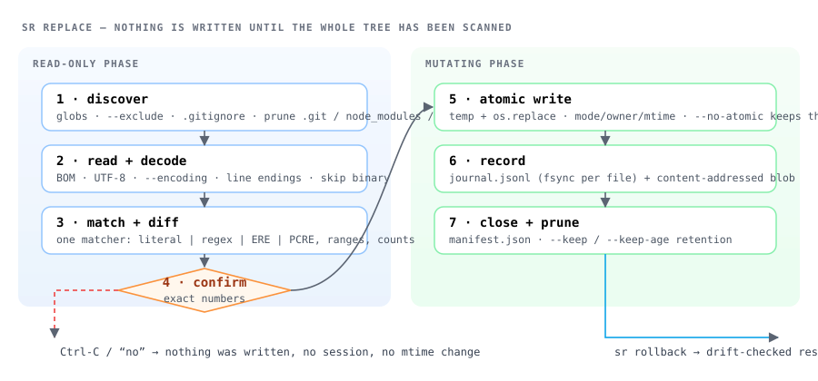
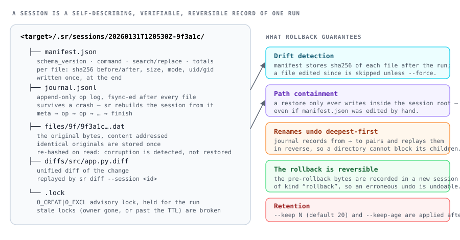

# sr — safe, auditable search &amp; replace for source trees

**`sr` rewrites text across a whole tree of files and keeps a journal of every
change, so any run can be inspected, diffed and undone.**

It is built for the jobs where `sed -i` is too blunt and an editor's
project-wide replace is too manual: retiring an API, bumping versions in a dozen
manifests, migrating a config key, normalising encodings, bulk-renaming files.

```console
$ sr find "old_api" -p '*.py'            # where is it?
src/app.py:12:5: result = old_api.call()
src/util.py:3:1: import old_api
2 matches in 2 files (scanned 128) in 41ms

$ sr diff "old_api" "new_api" -p '*.py'  # what exactly would change?
--- a/src/app.py
+++ b/src/app.py
@@ -12 +12 @@
-result = old_api.call()
+result = new_api.call()

$ sr replace "old_api" "new_api" -p '*.py'
[ok] src/app.py: 1 replacement(s)
[ok] src/util.py: 1 replacement(s)
Session                20260131T120530Z-9f3a1c
Rollback               sr rollback 9f3a1c

$ sr rollback                            # changed your mind?
[ok] session 9f3a1c rolled back (2 files)
```

---

## Contents

- [Why sr](#why-sr)
- [Install](#install)
- [Quick start](#quick-start)
- [Commands](#commands)
- [Matching](#matching)
- [Choosing files](#choosing-files)
- [Sessions, backups and rollback](#sessions-backups-and-rollback)
- [Automation: JSON, porcelain, exit codes](#automation-json-porcelain-exit-codes)
- [Configuration](#configuration)
- [Self-update](#self-update)
- [Shell completion and man page](#shell-completion-and-man-page)
- [Option reference](#option-reference)
- [Safety model](#safety-model)
- [Performance](#performance)
- [Troubleshooting](#troubleshooting)
- [Architecture](#architecture)
- [Development](#development)
- [Migrating from sr 6.x](#migrating-from-sr-6x)
- [License](#license)

---

## Why sr

Most search-and-replace tools are thin wrappers around `grep` + `sed`. That
design has four consequences that show up exactly when the edit is large enough
to matter:

| The problem | What sr does instead |
| --- | --- |
| **Counting and replacing disagree.** `grep -c` counts *lines*, `sed s///g` replaces *occurrences*, and `-i`/`-w`/`-E` are applied to one but not the other. The number you are shown is not the number of edits made. | One matcher does the counting, the previewing and the replacing. `-i`, `-w`, `--max-count` and `--line-range` behave identically in `find`, `diff` and `replace`. |
| **Patterns are silently regexes.** A search for `1.2.3` also matches `1x2y3`; a `$` in the replacement expands to something you did not write. | **Literal by default.** `.` is a dot, `$1` is `$1`. Regular expressions are opt-in (`--regex`, `--ere`, `--pcre`) and say so in every report. |
| **No undo.** `sed -i` rewrites in place; the `.bak` files (if any) are a flat pile with no record of which run produced them. | Every mutating run creates a **session**: content-addressed originals, a manifest with per-file SHA-256, an append-only journal and a diff. `sr rollback` restores it, detects files edited since, and journals the rollback itself so that can be undone too. |
| **The blast radius is discovered afterwards.** | The **scan phase completes before the first write.** The confirmation prompt, the progress bar and the summary all state real numbers, and `--dry-run` has literally no side effects — not even a `.sr/` directory. |

Plus the things that make it usable in a pipeline: stable documented exit codes,
`--json`, `--porcelain`, `--yes`, an advisory lock so two runs cannot
interleave, encoding/BOM/line-ending preservation, and no third-party runtime
dependencies at all.



---

## Install

`sr` is a single-file Python application. **Python 3.9 or newer is the only
requirement** — no packages to install, no compilation, no service. Tested on
3.9 through 3.14; see [Platforms](#install) for the OS story.

### Standalone (recommended)

```sh
curl -fsSL https://raw.githubusercontent.com/paulmann/sr-search-replace/main/scripts/install.sh | bash
```

The installer resolves the newest release, downloads `sr.pyz` and `sr.pyz.sha256`,
**verifies the checksum**, smoke-tests the download and installs it to
`/usr/local/bin/sr` (override with `--prefix ~/.local/bin`). A failed
verification installs nothing.

<details>
<summary>Manual install (air-gapped machines)</summary>

```sh
curl -fsSLO https://github.com/paulmann/sr-search-replace/releases/latest/download/sr.pyz
curl -fsSLO https://github.com/paulmann/sr-search-replace/releases/latest/download/sr.pyz.sha256
sha256sum -c sr.pyz.sha256          # must print OK
install -m 0755 sr.pyz /usr/local/bin/sr
```

</details>

### pipx / pip

```sh
pipx install sr-search-replace       # isolated, recommended
python3 -m pip install --user sr-search-replace
```

### npm

```sh
npm install -g sr-search-replace
```

The npm package bundles the same zipapp; the launcher finds `python3` and
reports a precise error if it is missing or too old.

### From source

```sh
git clone https://github.com/paulmann/sr-search-replace
cd sr-search-replace
make test          # the full suite (~730 tests), no network
make install       # zipapp + man page into PREFIX (default /usr/local)
```

### Verify any installation

```sh
sr --version       # version, interpreter, installation type
sr doctor          # environment, filesystem capabilities, config, session store
sr selftest        # end-to-end smoke test in a temporary directory
```

**Platforms.** Officially **Linux and macOS**. On Windows use **WSL2**.

The Python entry point does import and run on native win32, and `sr find` /
`--dry-run` will work, but the *write* path is not supported there and is not
tested in CI: sr relies on POSIX rename semantics, `os.chown`, `O_CREAT|O_EXCL`
advisory locks, inode preservation and `os.statvfs`. The npm launcher refuses on
`win32` for exactly that reason, and `pyproject.toml` carries no Windows
classifier. `sr doctor` reports which of those capabilities the current
filesystem actually provides.

---

## Quick start

```sh
# 1. look
sr find "TODO" -p '*.py'
sr diff "old" "new" -p '*.py'

# 2. do (creates a rollback session automatically)
sr replace "old" "new" -p '*.py'

# 3. review, and undo if needed
git diff                 # or: sr diff --session latest
sr rollback              # restores every file of the last session
```

A bare invocation is a shortcut for `replace`, and flags work in any position:

```sh
sr "*.py" "old" "new"            ==  sr replace "*.py" "old" "new"
sr "old" "new" -p '*.py' -i      ==  sr replace -i -p '*.py' "old" "new"
```

> Quote your globs. `sr replace *.py a b` lets the *shell* expand `*.py`;
> `sr replace '*.py' a b` lets sr walk the tree. Both work, but only the
> second one recurses.

### The built-in manual

`sr help` is a real manual — 27 topics, generated from the same schema that
drives the parser, so it cannot drift out of date.

```sh
sr help                    # overview and quick start
sr help topics             # the topic index
sr help matching           # literal vs --regex/--ere/--pcre, ranges, counts
sr help rollback           # drift detection, undoing a rollback
sr help replace            # everything one command accepts
sr help --max-count        # one option in depth, with an example
sr help examples           # ~40 ready-to-run command lines
sr help --all              # the whole manual in one document
sr help --json             # the same content, machine readable
man sr                     # the same content as a man page
```

---

## Commands

| Command | Aliases | What it does |
| --- | --- | --- |
| `sr replace GLOB SEARCH REPLACE` | `r` | Rewrite files in place, journalled |
| `sr find GLOB SEARCH` | `search`, `grep` | Show matches with `file:line:col`; never writes |
| `sr diff GLOB SEARCH REPLACE` | — | Preview the change as a unified diff |
| `sr rename GLOB SEARCH REPLACE` | `mv` | Rename files/directories by pattern |
| `sr rollback [SESSION]` | `undo`, `restore` | Restore files from a session |
| `sr sessions [list\|show\|delete\|prune\|size]` | `backups` | Inspect the audit trail |
| `sr update [--check]` | `upgrade` | Check for / install a newer release |
| `sr doctor` | `diagnose` | Verify the installation and environment |
| `sr config [list\|show\|init\|path\|validate]` | — | Manage configuration files |
| `sr completions [bash\|zsh\|fish]` | — | Generate shell completion |
| `sr selftest` | `smoke` | Built-in end-to-end smoke test |
| `sr help [TOPIC]` | — | The manual |

Every command accepts `-h/--help`.

### `replace`

```sh
sr replace "old_api" "new_api" -p '*.py' -p '*.pyx'
sr replace 'version = "(\d+)"' 'version = "\1.post0"' --regex -p setup.py
sr replace "Warning" "Notice" -i -w -p '*.md'
sr replace "old" "new" --dry-run                     # count only, write nothing
sr replace "old" "new" --interactive                 # confirm every hunk
sr replace "old" "new" --write=dir -o out            # copies; originals untouched
sr replace "old" "new" --write=stdout | less         # pipe the result
sr replace "old" "new" --line-range 1-20 -p 'header*'
sr replace "old" "new" --max-count 1
sr replace "old" "new" --encoding cp1251 -p '*.txt'
sr replace "MyClass" "YourClass" --rename -p '*.py'  # content *and* file names
```

### `find`

```sh
sr find "deprecated" -p '*.py'            # file:line:col + the line, highlighted
sr find "deprecated" --count              # per-file counts and a total
sr find "deprecated" -l                   # file names only
sr find "deprecated" -A 2 -B 2            # with context
sr find 'v\d+\.\d+' --regex --porcelain | cut -d: -f1 | sort -u
```

### `rename`

```sh
sr rename ".txt" ".md" -p '*.txt'
sr rename --regex '^photo-(\d+)\.jpeg$' 'img_\1.jpg'
sr rename "old" "new" --dry-run           # the plan, without executing it
```

Renames never move a file to another directory, collisions are detected *before*
anything is executed, and the whole thing is journalled so `sr rollback` undoes
it in reverse order.

### `doctor`, `selftest`, `config`, `completions`

```sh
sr doctor --json | jq '.checks[] | select(.status != "ok")'
sr selftest                                # 19 end-to-end checks in ~50 ms
sr config list --show-origin               # every option and where it came from
sr config init                             # documented template in ~/.config/sr/
sr completions --install                   # bash/zsh/fish, auto-detected
```

---

## Matching

Four pattern kinds. **Literal is the default**, which is the single most
important difference from `sed`:

```sh
sr replace "1.2.3" "1.2.4"            # a dot is a dot
sr replace '1\.2\.3' '1.2.4' --regex  # now it is a regex
```

| Flag | Syntax | Replacement semantics |
| --- | --- | --- |
| *(default)* | literal text | verbatim — `$1`, `\1` and `&` stay literal |
| `--regex` | Python `re` | template: `\1`, `\g<name>`, `\n`, `\\` |
| `--ere` | POSIX ERE (`grep -E`) | template, plus `[[:digit:]]`, `\<`, `\>` |
| `--pcre` | Perl (`grep -P`) | template, plus `\A`, `\z`, `(?<name>…)` |

Modifiers, applied uniformly to every kind:

| Flag | Effect |
| --- | --- |
| `-i`, `--ignore-case` | case-insensitive |
| `-w`, `--word-boundary` | whole words only |
| `-m`, `--multiline` | the pattern may span line boundaries |
| `-L`, `--line-range R` | restrict edits to lines `10`, `10-20`, `10-`, `-20` |
| `-M`, `--max-count N` | at most N replacements **per file** |
| `--no-global` | only the first occurrence **per line** |
| `--no-escapes` | do not interpret `\n`, `\t`, `\xNN` in fixed patterns |

Escape sequences recognised in fixed patterns: `\n \t \r \f \0 \e \\ \' \" \xNN`.
**`\b` is deliberately not one of them** — `C:\bin` must stay `C:\bin`, not
become a backspace. Unknown escapes keep their backslash.

Counting rule: **occurrences, not lines.** A line with three hits counts three,
in `find`, in the confirmation prompt, in `--max-count` and in the summary —
because all of them ask the same matcher.

```console
$ sr help matching        # the full chapter, with a cheat sheet
```

---

## Choosing files

```sh
sr replace a b -p '*.py'                     # by name (repeatable)
sr replace a b --include 'src/**/*.py'       # by path, ** supported
sr replace a b --exclude '*.min.js' --exclude 'vendor/*'
sr replace a b --file src/app.py --file src/main.py
git ls-files '*.py' | sr replace a b --files-from -
sr replace a b -C ~/projects/api             # another directory
sr replace a b --no-recursive --max-depth 2
sr replace a b --hidden -p '.env*'
sr replace a b --gitignore                   # honour .gitignore
sr replace a b --max-size 1MB --newer-than 7d
```

**Safe by default:** `.git`, `.hg`, `.svn`, `node_modules`, `vendor`, `dist`,
`build`, `target`, `__pycache__`, `.venv`, `.cache`, `.gradle`, `.terraform`,
`.idea`, `.vscode` are pruned *before* descending (so scanning them costs
nothing); `.DS_Store`, `*.orig`, `*.rej`, `*.bak`, `*.swp`, `*~` are skipped;
hidden files are skipped; symlinks are skipped; binary files are skipped; and
sr's own `.sr/` store is always pruned so a rollback can never feed on itself.

Add `-v` to see *why* a candidate was skipped — every rejection has a reason:

```console
$ sr find "x" -v
[verbose] skipped assets/logo.png: binary content (use --binary to force)
[verbose] skipped vendor/lib.js: excluded directory (vendor)
[verbose] skipped dist/app.js: ignored by .gitignore
```

---

## Sessions, backups and rollback

Every mutating run writes a session:

```
<target>/.sr/sessions/20260131T120530Z-9f3a1c/
├── manifest.json    who, what, when; per-file SHA-256, size, mode, uid/gid
├── journal.jsonl    append-only op log, fsync-ed per file (crash-safe)
├── files/9f/9f3a….dat   the original bytes, content addressed
└── diffs/src/app.py.diff
```

* **Content addressed** — identical originals are stored once, so 10 000 files
  sharing a header cost one blob. Every blob is re-hashed on read: a truncated
  or tampered backup is reported, never silently restored.
* **Journal first, manifest last** — a run killed halfway still has a usable
  journal, and sr rebuilds enough of the session from it to roll back.
* **Add `.sr/` to `.gitignore`.** Use `--backup-dir` to keep sessions outside
  the tree (read-only checkout, or you simply do not want the directory).


* **`--no-backup`** skips the store entirely — the right choice inside a clean
  git working tree, where `git checkout -- .` is your rollback.

### Rolling back

```sh
sr sessions                     # what can I undo?
sr rollback                     # newest session
sr rollback 9f3a1c              # by unique id suffix
sr rollback 2                   # ordinal: 2 = the second newest
sr rollback latest --dry-run    # show what would be restored
sr rollback latest --file src/app.py
sr diff --session latest        # the diffs that run recorded
```

**Drift detection.** The manifest stores the SHA-256 of each file *after* the
run. Before restoring, sr hashes the file as it is now:

| Current state | Behaviour |
| --- | --- |
| unchanged since the session | restored silently |
| **edited afterwards** | reported as drifted and **skipped** unless `--force` |
| deleted | restored (the directory is recreated) |

That is what makes `sr rollback` safe to run hours later: it will not throw away
edits you made in the meantime.

**The rollback is itself reversible.** Unless you pass `--no-safety-snapshot`,
the pre-rollback state is recorded in a new session of kind `rollback`:

```console
$ sr rollback --yes
[ok] session 9f3a1c rolled back (2 files)
Undo this rollback     sr rollback 20260131T120918Z-4b7e21
```

**Retention.** `--keep N` (default 20) and `--keep-age 30d` are applied after
every mutating run, so the store cannot grow without bound:

```sh
sr sessions size
sr sessions prune --keep 10 --keep-age 30d
```

---

## Automation: JSON, porcelain, exit codes

### `--json`

One document on stdout; **every diagnostic goes to stderr**, so
`sr … --json | jq` is always safe.

```sh
sr replace "$OLD" "$NEW" --yes --json --no-update-check > report.json
jq -e '.totals.failed == 0' report.json
jq -r '.files[] | select(.status=="changed") | "\(.rel_path): \(.replacements)"' report.json
```

```jsonc
{
  "version": "7.0.0",
  "dry_run": false,
  "root": "/home/me/project",
  "search": "old", "replacement": "new", "pattern_kind": "fixed",
  "duration_seconds": 0.412,
  "totals": {
    "scanned": 128, "changed": 7, "unchanged": 121, "skipped": 2,
    "failed": 0, "matches": 19, "replacements": 19, "renamed": 0,
    "bytes_read": 421887, "bytes_written": 20144
  },
  "session": { "id": "20260131T120530Z-9f3a1c", "…": "…" },
  "files": [
    { "path": "…", "rel_path": "src/app.py", "status": "changed",
      "matches": 3, "replacements": 3, "encoding": "utf-8",
      "size_before": 4012, "size_after": 4015,
      "diff": { "added": 3, "removed": 3, "changed": 6 } }
  ],
  "errors": [], "warnings": [], "exit_code": 0
}
```

Add `--diff` to include each file's patch text as `"patch"`.

### `--porcelain`

Stable `path:line:col:kind:text` records, designed to be cut and piped:

```sh
sr find "TODO" --porcelain | cut -d: -f1 | sort -u
```

### Exit codes

| Code | Meaning |
| --- | --- |
| `0` | success (for `find`/`replace`: at least one match) |
| `1` | runtime error (I/O failure, corrupt session, internal bug) |
| `2` | usage error (bad arguments, unreadable config, missing directory) |
| `3` | **no match** — nothing to do (grep/diff convention) |
| `4` | rollback failed for one or more files |
| `5` | self-update failed (network, checksum, permissions) |
| `6` | `sr selftest` failed: the installation is broken |
| `130` | interrupted with Ctrl-C |

Full table, per-command behaviour and the reasoning behind the split:
[`docs/EXIT_CODES.md`](docs/EXIT_CODES.md) (generated from `sr/exit_codes.py`)
or `sr help exit-codes`.

```sh
if sr replace "$OLD" "$NEW" --yes -q; then
  echo changed
elif [ $? -eq 3 ]; then
  echo "nothing to do"
else
  echo failed >&2; exit 1
fi
```

### CI checklist

* `--yes` — never prompt (sr refuses to prompt when stdin is not a terminal and
  exits non-zero instead of hanging the job)
* `--no-update-check` — keep the network out of the job
* `--json` or `--porcelain` — parse, do not scrape
* `--no-backup` when the workspace is a fresh checkout, or `--backup-dir`
  pointed at a cache directory when you want the rollback
* `SR_NO_COLOR=1` / `--color never` — no ANSI codes in the log
* `sr selftest` as a post-install step in the image

---

## Configuration

Precedence, lowest to highest:

```
built-in defaults
  → /etc/sr/sr.conf
  → $XDG_CONFIG_HOME/sr/sr.conf          (~/.config/sr/sr.conf)
  → <project root>/.srrc , <target>/.srrc , <target>/.sr/sr.conf
  → $SR_CONFIG  /  --config-file FILE
  → SR_* environment variables
  → --config KEY=VALUE
  → command line flags
```

A small, forgiving INI dialect:

```ini
# ~/.config/sr/sr.conf
ignore-case = true              # applies to every command
exclude = *.min.js, dist        # comma or whitespace separated

[replace]                       # `sr replace` only
confirm-threshold = 500
keep = 50

[find]
context = 1
```

Rules: keys are option names (`-` and `_` interchangeable) · a bare key means
`true` · booleans accept `true/false/yes/no/on/off/1/0` · sizes accept `512`,
`4KB`, `10MB`, `1.5GiB` · durations accept `30s`, `5m`, `7d` · repeating a key
builds a list · **an unknown key or an invalid value is a hard error with
`file:line`**, because a silently ignored typo is exactly what a bulk-edit tool
must not have.

```sh
sr config list --show-origin     # every option, its value, where it came from
sr config show confirm-threshold
sr config init                   # documented template
sr config path                   # the files sr reads, in priority order
sr config validate               # parse them all, report errors
```

Every option also has an `SR_*` environment variable — the option name in upper
case with `-` → `_`:

```sh
SR_IGNORE_CASE=true sr replace "warning" "notice" -p '*.md'
export SR_EXCLUDE='*.min.js vendor/*'
```

A project `.srrc` is worth committing: it turns the team's exclusion list,
confirmation threshold and backup policy into repository content instead of
tribal knowledge.

---

## Self-update

```sh
sr update --check              # is there a newer release?
sr update                      # install it
sr update --version 7.1.0      # pin a specific version
sr update --channel prerelease
sr update --source npm         # ask the npm registry instead of GitHub
```

`sr doctor` reports the installation type, which decides how an update is
applied:

| Installation | What `sr update` does |
| --- | --- |
| **standalone** (zipapp / installed script) | downloads the release asset, **verifies its SHA-256** against the published `sr.pyz.sha256`, smoke-tests it in a subprocess, keeps `<file>.bak`, then replaces the file atomically |
| **pip / pipx** | prints the exact upgrade command (the environment owns those files) |
| **npm** | prints `npm install -g sr-search-replace@latest` |
| **source checkout** | refuses, and tells you to `git pull && make install` |

Every step either succeeds or leaves the current installation untouched — a
checksum mismatch or a failing smoke test installs nothing.

**Background check.** At most once per 24 h, sr looks for a newer release on a
*daemon thread with a 2.5 s budget* and caches the answer under
`$XDG_CACHE_HOME/sr/update-check.json`. It never blocks a run: on a slow or
absent network nothing is printed and the cache is used next time. Disable it
with `--no-update-check` or `SR_NO_UPDATE_CHECK=1` — a good idea in CI and on
air-gapped machines.

```sh
sr update --version 7.0.0 && export SR_NO_UPDATE_CHECK=1     # pin
SR_GITHUB_TOKEN=… sr update --check                          # higher API limit
```

---

## Shell completion and man page

```sh
sr completions --install                 # auto-detects bash / zsh / fish
sr completions bash >> ~/.bash_completion
sr completions zsh  > "${fpath[1]}/_sr"
sr completions fish > ~/.config/fish/completions/sr.fish
man sr
```

Both are **generated from the live option schema** (`make completions`,
`make man`), so a new flag appears in the parser, the config layer, the help
system, the completions and the man page from one declaration — and CI fails if
a committed artefact drifts out of date.

`sr help` pages its output through `$PAGER` on a terminal; `--no-pager`
disables that. `sr … | head` exits 0 rather than dumping a `BrokenPipeError`.

---

## Option reference

61 tunables. Every one is also a config-file key and an `SR_*` variable.
`sr help options` prints this table with examples; `sr help --<flag>` explains
one option in depth.

<!-- BEGIN OPTIONS — generated by scripts/gen_options_table.py; do not edit -->

60 cross-command options. Each one is also a configuration key (see `sr config list`) and an `SR_*` environment variable.

<details open>
<summary><b>Target selection</b> (18)</summary>

| Flag | Environment | Default | What it does |
| --- | --- | --- | --- |
| `-C`, `--target` `DIR` | `SR_TARGET` | `.` | Directory to operate on (default: the current directory). *(`replace`, `find`, `diff`, `rename`)* |
| `-p`, `--pattern` `GLOB` | `SR_PATTERN` | — | Only files whose name matches GLOB (repeatable). Default: every text file. *(`replace`, `find`, `diff`, `rename`)* |
| `--file` `PATH` | `SR_FILE` | — | Explicit file to process, bypassing pattern matching (repeatable). *(`replace`, `find`, `diff`, `rename`)* |
| `--files-from` `FILE` | `SR_FILES_FROM` | — | Read the list of target files from FILE, one per line ('-' for stdin). *(`replace`, `find`, `diff`, `rename`)* |
| `--include` `GLOB` | `SR_INCLUDE` | — | Additional include glob, may contain '/' and '**' (repeatable). *(`replace`, `find`, `diff`, `rename`)* |
| `--exclude` `GLOB` | `SR_EXCLUDE` | — | Exclude glob; wins over --include and --pattern (repeatable). *(`replace`, `find`, `diff`, `rename`)* |
| `--exclude-dir` `NAME` | `SR_EXCLUDE_DIR` | — | Prune a directory by name (repeatable; adds to the built-in list). *(`replace`, `find`, `diff`, `rename`)* |
| `--no-default-excludes` | `SR_NO_DEFAULT_EXCLUDES` | — | Do not apply the built-in exclude lists (node_modules, dist, *.bak …). *(`replace`, `find`, `diff`, `rename`)* |
| `-1`, `--no-recursive` | `SR_NO_RECURSIVE` | — | Only the target directory itself, no subdirectories. *(`replace`, `find`, `diff`, `rename`)* |
| `--max-depth` `N` | `SR_MAX_DEPTH` | — | Descend at most N levels below the target directory. *(`replace`, `find`, `diff`, `rename`)* |
| `--hidden` | `SR_HIDDEN` | — | Also process dotfiles and dot-directories. *(`replace`, `find`, `diff`, `rename`)* |
| `--symlinks` | `SR_SYMLINKS` | — | Follow symlinked files (they are skipped by default). *(`replace`, `find`, `diff`, `rename`)* |
| `--gitignore` | `SR_GITIGNORE` | — | Honour .gitignore files (including the global excludesfile). *(`replace`, `find`, `diff`, `rename`)* |
| `--max-size` `SIZE` | `SR_MAX_SIZE` | `100.0 MB` | Skip files larger than SIZE (default 100MB; a bare number means megabytes). *(`replace`, `find`, `diff`, `rename`)* |
| `--min-size` `SIZE` | `SR_MIN_SIZE` | — | Skip files smaller than SIZE. *(`replace`, `find`, `diff`, `rename`)* |
| `--newer-than` `AGE` | `SR_NEWER_THAN` | — | Only files modified within AGE (e.g. 24h, 7d, 30m). *(`replace`, `find`, `diff`, `rename`)* |
| `--older-than` `AGE` | `SR_OLDER_THAN` | — | Only files not modified within AGE. *(`replace`, `find`, `diff`, `rename`)* |
| `--binary` | `SR_BINARY` | — | Process files that look binary instead of skipping them. *(`replace`, `find`, `diff`, `rename`)* |

</details>

<details open>
<summary><b>Matching</b> (12)</summary>

| Flag | Environment | Default | What it does |
| --- | --- | --- | --- |
| `-R`, `--regex` | `SR_REGEX` | — | Treat PATTERN as a Python regular expression. *(`replace`, `find`, `diff`, `rename`)* |
| `--ere` | `SR_ERE` | — | Treat PATTERN as a POSIX Extended Regular Expression (grep -E syntax). *(`replace`, `find`, `diff`, `rename`)* |
| `--pcre` | `SR_PCRE` | — | Treat PATTERN as a Perl-compatible regular expression. *(`replace`, `find`, `diff`, `rename`)* |
| `--pattern-kind` `KIND` | `SR_PATTERN_KIND` | `fixed` | Explicit pattern kind: fixed, regex, ere or pcre — one of `fixed`, `regex`, `ere`, `pcre`. *(`replace`, `find`, `diff`, `rename`)* |
| `-i`, `--ignore-case` | `SR_IGNORE_CASE` | — | Case-insensitive matching. *(`replace`, `find`, `diff`, `rename`)* |
| `-w`, `--word-boundary` | `SR_WORD_BOUNDARY` | — | Match whole words only. *(`replace`, `find`, `diff`, `rename`)* |
| `-m`, `--multiline` | `SR_MULTILINE` | — | Allow the pattern to span line boundaries ('.' matches newline). *(`replace`, `find`, `diff`, `rename`)* |
| `--no-escapes` | `SR_NO_ESCAPES` | — | Do not interpret \n, \t, \xNN in fixed patterns/replacements. *(`replace`, `find`, `diff`, `rename`)* |
| `-L`, `--line-range` `RANGE` | `SR_LINE_RANGE` | — | Restrict edits to a line range: 10, 10-20, 10- or -20. *(`replace`, `find`, `diff`, `rename`)* |
| `-M`, `--max-count` `N` | `SR_MAX_COUNT` | — | Replace at most N occurrences per file. *(`replace`, `find`, `diff`, `rename`)* |
| `--no-global` | `SR_NO_GLOBAL` | — | Replace only the first occurrence on each line. *(`replace`, `find`, `diff`, `rename`)* |
| `--context` `N` | `SR_CONTEXT` | `3` | Lines of context around a match in preview/diff output (default 3). *(`replace`, `find`, `diff`, `rename`)* |

</details>

<details open>
<summary><b>Action</b> (13)</summary>

| Flag | Environment | Default | What it does |
| --- | --- | --- | --- |
| `-n`, `--dry-run` | `SR_DRY_RUN` | — | Report what would change; never write, never create a session. *(`replace`, `find`, `diff`, `rename`)* |
| `--diff` | `SR_DIFF` | — | Show a unified diff of every change (implies a preview). *(`replace`, `find`, `diff`, `rename`)* |
| `-I`, `--interactive` | `SR_INTERACTIVE` | — | Confirm every hunk before it is written. *(`replace`, `find`, `diff`, `rename`)* |
| `--write` `MODE` | `SR_WRITE` | `in-place` | Where the result goes: in-place (default), stdout, or --output-dir — one of `in-place`, `stdout`, `dir`. *(`replace`)* |
| `-o`, `--output-dir` `DIR` | `SR_OUTPUT_DIR` | — | Write modified copies under DIR, mirroring the tree (needs --write=dir). *(`replace`)* |
| `--suffix` `EXT` | `SR_SUFFIX` | — | When writing copies, append EXT to the file name instead of mirroring. *(`replace`)* |
| `--rename` | `SR_RENAME` | — | Also apply the replacement to file and directory names. *(`replace`)* |
| `--rename-only` | `SR_RENAME_ONLY` | — | Rename matching files/directories without touching their content. *(`replace`)* |
| `-E`, `--encoding` `NAME` | `SR_ENCODING` | — | Force an encoding (utf-8, cp1251, latin-1 …); default is auto-detect. *(`replace`, `find`, `diff`, `rename`)* |
| `--encoding-error` `POLICY` | `SR_ENCODING_ERROR` | `strict` | What to do with undecodable bytes: strict (skip), replace, ignore — one of `strict`, `replace`, `ignore`. *(`replace`, `find`, `diff`, `rename`)* |
| `--line-endings` `MODE` | `SR_LINE_ENDINGS` | `preserve` | Keep the file's line endings (default) or normalise to LF/CRLF — one of `preserve`, `lf`, `crlf`. *(`replace`)* |
| `--preserve-mtime` | `SR_PRESERVE_MTIME` | — | Restore the original modification time after writing. *(`replace`)* |
| `-y`, `--yes` | `SR_YES` | — | Answer 'yes' to every prompt; required for unattended runs in CI. *(`replace`, `rename`, `rollback`, `sessions`, `update`)* |

</details>

<details open>
<summary><b>Safety & backups</b> (9)</summary>

| Flag | Environment | Default | What it does |
| --- | --- | --- | --- |
| `--backup`, `--no-backup` | `SR_BACKUP` | on | Store originals in a session so the run can be rolled back (default on). *(`replace`, `rename`)* |
| `--backup-dir` `DIR` | `SR_BACKUP_DIR` | — | Where to keep sessions (default <target>/.sr). Use an absolute path to keep them out of the tree. *(`replace`, `rename`)* |
| `--keep` `N` | `SR_KEEP` | `20` | Keep at most N sessions; older ones are pruned after a run (default 20, 0 disables pruning). *(`replace`, `rename`, `sessions`)* |
| `--keep-age` `AGE` | `SR_KEEP_AGE` | — | Also drop sessions older than AGE (e.g. 30d). *(`replace`, `rename`, `sessions`)* |
| `--atomic`, `--no-atomic` | `SR_ATOMIC` | on | Write via a temporary file + rename (default) or rewrite the inode in place. *(`replace`)* |
| `--lock`, `--no-lock` | `SR_LOCK` | on | Take an advisory lock so two sr runs cannot interleave (default on). *(`replace`, `rename`)* |
| `--confirm-threshold` `N` | `SR_CONFIRM_THRESHOLD` | `50` | Ask for confirmation when more than N files would change (0 disables). *(`replace`, `rename`)* |
| `--allow-root` | `SR_ALLOW_ROOT` | — | Permit a mutating run with euid 0 (refused by default). *(`replace`, `rename`)* |
| `-f`, `--force` | `SR_FORCE` | — | Override safety guards (drifted files, read-only warnings, existing targets). *(`replace`, `rename`, `rollback`)* |

</details>

<details open>
<summary><b>Output & reporting</b> (8)</summary>

| Flag | Environment | Default | What it does |
| --- | --- | --- | --- |
| `-v`, `--verbose` | `SR_VERBOSE` | — | Show per-file results and the reason skipped files were skipped. *(all)* |
| `-q`, `--quiet` | `SR_QUIET` | — | Only errors; suitable for scripts. *(all)* |
| `--verbosity` `LEVEL` | `SR_VERBOSITY` | `normal` | Set the log level explicitly (overrides -v/-q) — one of `quiet`, `normal`, `verbose`, `debug`. *(all)* |
| `--color`, `--no-color` `WHEN` | `SR_COLOR` | `auto` | Colourise output. Honours NO_COLOR and CLICOLOR_FORCE — one of `auto`, `always`, `never`. *(all)* |
| `--json` | `SR_JSON` | — | Emit a single JSON document on stdout; diagnostics go to stderr. *(all)* |
| `--porcelain` | `SR_PORCELAIN` | — | Emit stable 'path:line:col:text' records, one per match. *(`replace`, `find`, `diff`, `rename`)* |
| `--progress`, `--no-progress` | `SR_PROGRESS` | on | Show a progress bar on a terminal (default on). *(`replace`, `find`, `diff`, `rename`)* |
| `--summary`, `--no-summary` | `SR_SUMMARY` | on | Print the run summary (default on). *(`replace`, `find`, `diff`, `rename`)* |

</details>

<details>
<summary><b>Command-local options</b> (accepted by one command only)</summary>

These are declared next to their subparser rather than in the shared
schema, because they exist for exactly one command. They are generated
into this table from the live parser, so they cannot go stale.

**Global**

| Flag | What it does |
| --- | --- |
| `--help-all` | Show help for every subcommand and option |
| `-V`, `--version` | Print version, license and update information |
| `--debug` | Debug logging (same as -vv) |
| `--no-update-check` | Do not check for a newer release |
| `--config` `KEY=VALUE` | Override one configuration value (repeatable) |
| `--config-file` `FILE` | Read an extra configuration file (repeatable) |

**`sr replace`**

| Flag | What it does |
| --- | --- |
| `--debug` | Debug logging (same as -vv) |
| `--no-update-check` | Do not check for a newer release |
| `--config` `KEY=VALUE` | Override one configuration value (repeatable) |
| `--config-file` `FILE` | Read an extra configuration file (repeatable) |
| `--glob` `GLOB` | File name pattern (repeatable); alternative to the positional GLOB |

**`sr find`**

| Flag | What it does |
| --- | --- |
| `--debug` | Debug logging (same as -vv) |
| `--no-update-check` | Do not check for a newer release |
| `--config` `KEY=VALUE` | Override one configuration value (repeatable) |
| `--config-file` `FILE` | Read an extra configuration file (repeatable) |
| `--glob` `GLOB` | File name pattern (repeatable) |
| `-c`, `--count` | Print only the number of matches per file (and a total) |
| `-l`, `--files-with-matches` | Print only the names of files that contain a match |
| `-A`, `--after-context` `N` | Print N lines after each match |
| `-B`, `--before-context` `N` | Print N lines before each match |
| `--highlight` | Force match highlighting even when writing to a file |

**`sr diff`**

| Flag | What it does |
| --- | --- |
| `--debug` | Debug logging (same as -vv) |
| `--no-update-check` | Do not check for a newer release |
| `--config` `KEY=VALUE` | Override one configuration value (repeatable) |
| `--config-file` `FILE` | Read an extra configuration file (repeatable) |
| `--session` `SESSION` | Instead of computing a diff, show the diff stored in a session |

**`sr rename`**

| Flag | What it does |
| --- | --- |
| `--debug` | Debug logging (same as -vv) |
| `--no-update-check` | Do not check for a newer release |
| `--config` `KEY=VALUE` | Override one configuration value (repeatable) |
| `--config-file` `FILE` | Read an extra configuration file (repeatable) |
| `--directories` | Also rename directories that match (default: files only) |

**`sr rollback`**

| Flag | What it does |
| --- | --- |
| `--no-safety-snapshot` | Do not record the pre-rollback state (not recommended) |
| `--debug` | Debug logging (same as -vv) |
| `--no-update-check` | Do not check for a newer release |
| `--config` `KEY=VALUE` | Override one configuration value (repeatable) |
| `--config-file` `FILE` | Read an extra configuration file (repeatable) |

**`sr sessions`**

| Flag | What it does |
| --- | --- |
| `--limit` `N` | List at most N sessions (default 20) |
| `--files` | Include the per-file list in `show` |
| `--debug` | Debug logging (same as -vv) |
| `--no-update-check` | Do not check for a newer release |
| `--config` `KEY=VALUE` | Override one configuration value (repeatable) |
| `--config-file` `FILE` | Read an extra configuration file (repeatable) |

**`sr update`**

| Flag | What it does |
| --- | --- |
| `--check` | Only report whether an update exists |
| `--version` `VERSION` | Install a specific version (e.g. 7.1.0) |
| `--channel` | Release channel (default: stable) |
| `--source` | Where to fetch release information (default: github) |
| `--repo` `OWNER/NAME` | Override the GitHub repository |
| `--timeout` `SECONDS` | Network timeout (default 20) |
| `--path` `FILE` | Standalone file to update (default: auto-detect) |
| `--no-verify` | Install without SHA-256 verification. Verification is fail-closed by default, so this is the only way past a missing checksum — use it only for a mirror you trust |
| `--debug` | Debug logging (same as -vv) |
| `--no-update-check` | Do not check for a newer release |
| `--config` `KEY=VALUE` | Override one configuration value (repeatable) |
| `--config-file` `FILE` | Read an extra configuration file (repeatable) |

**`sr doctor`**

| Flag | What it does |
| --- | --- |
| `--offline` | Skip the network reachability probe |
| `--debug` | Debug logging (same as -vv) |
| `--no-update-check` | Do not check for a newer release |
| `--config` `KEY=VALUE` | Override one configuration value (repeatable) |
| `--config-file` `FILE` | Read an extra configuration file (repeatable) |

**`sr completions`**

| Flag | What it does |
| --- | --- |
| `--install` | Write the script into the shell's completion directory |
| `--debug` | Debug logging (same as -vv) |
| `--no-update-check` | Do not check for a newer release |
| `--config` `KEY=VALUE` | Override one configuration value (repeatable) |
| `--config-file` `FILE` | Read an extra configuration file (repeatable) |

**`sr config`**

| Flag | What it does |
| --- | --- |
| `--option` `NAME` | Option name for `show`, e.g. `sr config show --option max-size` |
| `--show-origin` | Show where each value comes from |
| `--debug` | Debug logging (same as -vv) |
| `--no-update-check` | Do not check for a newer release |
| `--config` `KEY=VALUE` | Override one configuration value (repeatable) |
| `--config-file` `FILE` | Read an extra configuration file (repeatable) |

**`sr selftest`**

| Flag | What it does |
| --- | --- |
| `--quick` | Run only the essential checks |
| `--debug` | Debug logging (same as -vv) |
| `--no-update-check` | Do not check for a newer release |
| `--config` `KEY=VALUE` | Override one configuration value (repeatable) |
| `--config-file` `FILE` | Read an extra configuration file (repeatable) |

**`sr help`**

| Flag | What it does |
| --- | --- |
| `--option` `NAME` | Explain one option, e.g. `sr help --option max-count` |
| `--all` | Same as `sr --help-all` |
| `--no-pager` | Never page the output |

</details>

<!-- END OPTIONS -->

Global flags: `-h/--help`, `--help-all`, `-V/--version`, `-v/--verbose` (`-vv`
= debug), `-q/--quiet`, `--debug`, `--json`, `--porcelain`, `--color
auto|always|never`, `--no-update-check`, `--config KEY=VALUE`, `--config-file
FILE`.

---

## Safety model

Threat model: sr runs with your privileges over your files, so the risks are
**accidental destruction**, **unintended scope** and **supply-chain attacks on
the update path** — not remote exploitation.

**Accidental destruction**

- literal matching by default: a pattern is never silently a regex
- binary files are skipped unless `--binary` or an explicit `--encoding` is given
- undecodable files are skipped and reported — never rewritten with a guessed
  encoding (BOM, UTF-8, `--encoding`, then `--encoding-error`)
- the scan phase completes before the first write, so the confirmation prompt
  states real numbers (`--confirm-threshold`, default 50 files)
- VCS directories, build output and `.sr/` are pruned by default
- symlinks are skipped by default, so a link cannot smuggle a file outside the
  target tree into the edit set
- atomic writes by default (`--atomic`): a crash can never leave a truncated
  file; `--no-atomic` preserves the inode instead, for hard links
- **running as root is refused** unless `--allow-root`
- **rewriting `/`, `/etc`, `/usr` or `$HOME` directly is refused** unless
  `--force`
- every mutating run is journalled and reversible; rollbacks are reversible too
- rollback refuses drifted files, refuses paths outside the session root, and
  re-hashes every blob before writing it

**Unintended scope**

- `-v` prints every skipped candidate *with the reason*
- `--dry-run` and `--diff` make the blast radius visible before committing
- `--write=dir -o out` produces copies and touches nothing

**Update path (supply chain)**

- HTTPS only, enforced in code (`_require_https` rejects `file:` and custom
  schemes before `urlopen` sees them)
- **verification is fail-closed**: a missing checksum asset, an unreachable or
  empty checksum file, a malformed digest and a digest mismatch all abort the
  update and install nothing — `scripts/install.sh` enforces the same five rules
- the download is smoke-tested in a subprocess before it replaces anything
- the previous file is kept as `<file>.bak`
- `--no-verify` is the only way past that, and warns loudly
- the background check is read-only, cached, non-blocking and can be disabled

**Data handling**

- file content never leaves the machine; the only network calls are the release
  lookup and the release download
- sessions store original bytes under `<target>/.sr` — **not encrypted**; treat
  that directory with the same care as the files themselves and keep it out of
  git
- no telemetry, no analytics, no crash reporting: a crash prints a traceback
  locally (with `SR_DEBUG=1`) and suggests opening an issue

See [`SECURITY.md`](SECURITY.md) for reporting a vulnerability.

---

## Performance

Where the time goes, in order of impact: **discovery** (pruning is the whole
game — excluded directories are never descended into), **reading and decoding**
(every candidate is read once), **matching** (one compiled pattern reused for
every file), **writing** (one atomic write plus an fsync per changed file).

On a laptop SSD a literal replacement across ~10 000 text files (≈120 MB) takes
a few seconds. The scan phase doubles the read cost of a mutating run — that is
the price of an accurate prompt and of a `--dry-run` with no side effects.

```sh
sr replace a b --files-from <(git ls-files '*.py')   # skip discovery entirely
sr replace a b --no-backup                           # no blob writes (git is your net)
sr replace a b -q --no-progress --no-summary         # script-friendly
sr replace a b --max-size 1MB --newer-than 7d        # shrink the candidate set
```

**No parallelism by default, deliberately.** A bulk rewrite is I/O bound, and
parallel writers make the journal order — and therefore rollback — harder to
reason about. If you need throughput, shard by directory with `-C` and run the
shards yourself: each shard gets its own session and can be rolled back
independently.

---

## Troubleshooting

Start with `sr doctor` (interpreter, installation type and writability, config
files, session store, filesystem capabilities, locking, disk, network) and
`sr selftest` (the whole pipeline end to end).

| Symptom | Cause and fix |
| --- | --- |
| `no files matched the target selection` | Unquoted glob (the shell expanded it) · hidden or excluded files · `--gitignore` · wrong root. Run with `-v` to see every rejection and its reason. |
| `skipped: binary content` | NUL byte or >30 % non-text bytes in the first 8 KiB. UTF-16 without a BOM looks binary. Use `--encoding utf-16` (decodes it properly) or `--binary` (forces it). |
| `cannot decode as utf-8` | It is not UTF-8. Pass `--encoding cp1251` (or the real encoding), or `--encoding-error replace` to force a lossy decode. sr never guesses silently. |
| Line endings changed | They are preserved per file by default. `--line-endings lf` normalises on purpose. |
| `file changed after the session` | Correct behaviour: the file was edited after the session, so restoring would lose those edits. Review with `sr diff --session <id>`, then `--force` if you accept the loss. |
| `another sr process is using <session>` | A held lock. sr breaks locks whose owner process is gone; otherwise delete `.sr/sessions/<id>/.lock`. |
| Slower than expected | `-v` prints discovery statistics. Check that `node_modules`/`dist` are pruned; consider `--files-from`. |
| sr crashed | Re-run with `SR_DEBUG=1` for a traceback and open an issue with `sr doctor --json` attached. |

```sh
sr help troubleshooting      # the full chapter
```

---

## Architecture

```
sr-cli, sr.py             launchers (POSIX sh / thin Python)
sr/
  cli.py                  preprocessing, dispatch, error handling
  cli_support.py          argparse actions, schema → parser plumbing
  registry.py             the subcommand table
  options.py              THE option schema (single source of truth)
  config.py               config files, env vars, precedence
  context.py              per-run context: console, config, prompts, guards
  console.py              colour, verbosity, text/json/porcelain output
  pattern.py              the matcher: literal/regex/ERE/PCRE, ranges, counts
  discovery.py            walking, pruning, globs, .gitignore, filters
  textio.py               encoding, BOM, line endings, binary sniffing
  replace.py              the engine: scan → confirm → write → record
  find.py                 read-only search rendering (grep-like output)
  diffview.py             unified diffs and their statistics
  atomic.py               atomic, permission-preserving writes
  session.py              sessions: manifest, journal, blob store, restore
  errors.py               exception hierarchy → exit codes
  exit_codes.py           the frozen exit-code contract
  util.py, version.py     sizes, durations, hashes, ids, semver
  help_system.py          the manual: 27 topics, generated option reference
  commands/               one module per subcommand (+ shared helpers)
tools/                    build helpers: zipapp, man page
scripts/                  install.sh, version sync, release notes
tests/                    ~590 test functions → ~730 tests; hermetic (no network, no $HOME)
npm/                      the npm package (launcher + bundled zipapp)
```

Data flow of `sr replace`:

```
argv → preprocess → argparse → Context (config merge, console)
     → PatternSpec (validated once)
     → DiscoveryOptions → discover() → candidate list
     → SCAN:   read → decode → match → diff            (nothing written)
     → confirm (accurate numbers)
     → WRITE:  atomic write → session.record_replace()
     → close session (manifest) → prune → report → exit code
```

Invariants worth knowing:

- the scan phase never writes, so `--dry-run` has literally no side effects
- counting and replacing share one matcher, so the reported number of
  replacements equals the number of edits made
- the journal is fsync-ed per file and the manifest only at the end, so an
  interrupted run is still recoverable
- blobs are content addressed and re-hashed on read: a corrupt backup is
  detected, never silently restored
- a session may never cause a write outside its own root, even if the manifest
  is edited by hand

---

## Development

```sh
git clone https://github.com/paulmann/sr-search-replace
cd sr-search-replace
python3 -m venv .venv && . .venv/bin/activate
make install-dev        # editable install + pytest/ruff/mypy
make test               # the full suite
make lint               # ruff
make dist               # build/sr.pyz (the release asset)
make man completions    # regenerate the derived artefacts
make check              # lint + types + tests + dist + man + versions + selftest
```

Conventions (all enforced by review or CI):

- a new option goes into `sr/options.py` **and nowhere else** — the parser,
  config layer, help text, man page and completions are all derived from it
- every command module exposes `cmd_<name>(context) -> int`
- errors are `SrError` subclasses carrying an exit code and a one-line hint
- **no third-party runtime dependencies, ever**
- tests must not touch the network, the real `$HOME`, or the cwd

Release checklist: bump `version` in `pyproject.toml` → `make sync-version V=x.y.z`
→ update `CHANGELOG.md` → `make release-check` → commit, tag `vx.y.z`, push.
CI publishes to PyPI and npm, builds `sr.pyz`, and attaches `sr.pyz` +
`sr.pyz.sha256` to the GitHub Release — which is exactly what `sr update` downloads
and verifies.

See [`CONTRIBUTING.md`](CONTRIBUTING.md).

---

## Migrating from sr 6.x

sr 7 is a rewrite in Python with a redesigned command line. The 6.x flags are
**not** accepted.

| 6.x (bash) | 7.x |
| --- | --- |
| `sr "*.py" "a" "b"` | `sr replace "a" "b" -p '*.py'` |
| `sr -i` / `--ignore-case` | `sr replace -i …` *(unchanged)* |
| `sr -E` / `--extended-regex` | `sr replace --ere …` |
| `sr -w` / `--word-boundary` | `sr replace -w …` *(unchanged)* |
| `sr -m` / `--multiline` | `sr replace -m …` *(unchanged)* |
| `sr -nr` / `--no-recursive` | `sr replace --no-recursive` |
| `sr -nb` / `--no-backup` | `sr replace --no-backup` |
| `sr -nbf` / `--no-backup-folder` | `sr replace --backup-dir <dir>` |
| `sr -fb` / `--force-backup` | *(backups are on by default)* |
| `sr -xs` / `--max-size MB` | `sr replace --max-size 10MB` |
| `sr -xp` / `--exclude-patterns` | `sr replace --exclude GLOB` (repeatable) |
| `sr -xd` / `--exclude-dirs` | `sr replace --exclude-dir NAME` (repeatable) |
| `sr -sd` / `--search-dir DIR` | `sr replace -C DIR` |
| `sr -od` / `--output-dir DIR`<br>`sr -mode copy` | `sr replace --write=dir -o DIR` |
| `sr --dry-run` | `sr replace --dry-run` *(unchanged)* |
| `sr --rollback[=DIR]` | `sr rollback [SESSION]` |
| `sr --rollback-list` | `sr sessions` |
| `sr --binary` | `sr replace --binary` *(unchanged)* |
| `sr --binary-method=…` | *(one robust sniffer; no knob)* |
| `sr --find-opts` / `--sed-opts` / `--grep-opts` | **removed** — those strings were injected into a shell command line. Use the typed equivalents: `--include`, `--max-depth`, `--newer-than`, `--exclude-dir`, … |
| `sr --delimiter CHAR` | **removed** — no shell quoting is involved any more, so no delimiter can collide |
| `SR_*` variables | still one per option, named after the new flags |

**Behaviour changes worth knowing**

- Patterns are **literal by default**. 6.x escaped the search string for `sed`,
  which also meant `-E` was effectively broken; 7.x separates literal and regex
  cleanly.
- Replacement counts are **occurrences**, not matching lines.
- `--dry-run` writes **nothing at all** (6.x created a backup directory).
- Sessions live in `.sr/` instead of `sr.backup.<timestamp>/` in the project
  root. 6.x backup directories are left untouched — restore from them with the
  6.x script from the `v6.1.0` release assets, or copy the files back by hand
  (the layout is a plain directory mirror).
- Exit codes are documented and stable: "no match" is `3`, not `1`.
- 6.x required `bc`, `file`, GNU `sed`/`grep` and bash 4 at runtime and failed
  with exit `127` when any of them was missing. 7.x needs Python 3.9+ and
  nothing else.

```sh
sr help compat        # the same table, plus the reasoning
```

---

## License

MIT © Mikhail Deynekin — [deynekin.com](https://deynekin.com)

```
sr help license
```
